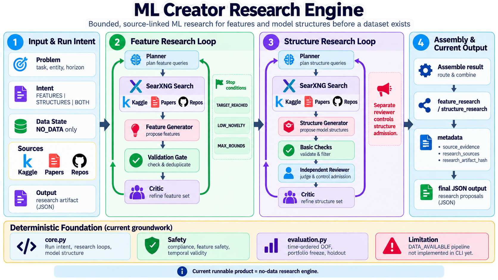

# ML Creator — Agentic ML Research Engine

<p align="center">
  
</p>

**ML Creator is an agent-driven research engine that iteratively discovers, critiques, and curates machine-learning feature ideas and model architectures — even before a dataset exists.**

Rather than producing a one-shot list of generic suggestions, ML Creator coordinates specialized **LLM agent roles** with targeted web search, source constraints, an independent structure-admission review, and feedback-driven research rounds.

> **Current scope:** This is a bounded **NO_DATA research agent**, not an AutoML training system. It proposes source-linked research hypotheses; it does not train models or demonstrate performance improvements.

## Agent architecture

```text
                         Problem + research intent
                                   |
                         Agent orchestration loop
                                   |
                        +----------v-----------+
                        |  Search Planner Agent |
                        |  queries informed by  |
                        |  previous gaps        |
                        +----------+-----------+
                                   |
                        +----------v-----------+
                        | SearXNG Search Tool   |
                        | Kaggle / Papers /     |
                        | Code Repositories     |
                        +----------+-----------+
                                   |
                        +----------v-----------+
                        | Candidate Generator   |
                        | feature concepts or   |
                        | model architectures   |
                        +----------+-----------+
                                   |
                        +----------v-----------+
                        | Deterministic Gates   |
                        | schema, URL, IDs and  |
                        | duplicate checks      |
                        +----------+-----------+
                                   |
                 STRUCTURES only:  v
                        +----------------------+
                        | Independent Admission|
                        | Reviewer (LLM)       |
                        | architecture, novelty|
                        | and snippet support  |
                        +----------+-----------+
                                   |
                        +----------v-----------+
                        | Research Critic Agent |
                        | coverage / missing    |
                        | mechanisms or families|
                        +----------+-----------+
                                   |
                       gaps + accepted discoveries
                                   |
                    next round or bounded termination
                                   |
                   TARGET_REACHED / LOW_NOVELTY /
                            MAX_ROUNDS
```

The **planner, candidate generator, and critic** are prompt-defined roles invoked by the research orchestration code. The **admission reviewer** is an additional LLM gate for model structures; it can use a separately configured endpoint. This is a **sequential, iterative agent workflow**, not a claim of autonomous parallel agents or a general-purpose agent framework.

## Specialized agent roles

| Agent / component | Responsibility | How the result is used |
| --- | --- | --- |
| **Search Planner Agent** | Generates two focused queries per round using the problem, accepted discoveries and gaps identified by the critic | Guides source retrieval toward underexplored ideas |
| **Search Tool (SearXNG)** | Retrieves source-linked snippets from selected Kaggle, paper and repository domains | Supplies a constrained evidence pool |
| **Candidate Generator** | Produces structured feature concepts or connected model architectures from retrieved snippets | Proposes new research hypotheses |
| **Deterministic Validation** | Checks required fields, source URLs, exact IDs/names, and valid candidate structure | Rejects malformed, unsupported or repeat submissions |
| **Independent Structure Admission Reviewer** | Assesses whether a candidate is a real architecture, semantically new, and supported by supplied snippets | Accepts or rejects model-structure proposals |
| **Research Critic Agent** | Identifies missing feature mechanisms or architecture families after each round | Feeds gaps into the next planning cycle |
| **Research Orchestrator** | Tracks accepted proposals, round logs, checkpoints and stopping conditions | Produces bounded, auditable output |

### How agents collaborate

1. **Plan:** The planner uses the prediction problem, existing candidates and unresolved gaps to create targeted search queries.
2. **Retrieve:** SearXNG returns snippets; configured source categories restrict the candidate evidence.
3. **Generate:** The generator emits structured JSON proposals that cite URLs returned in the current search round.
4. **Validate:** Python checks proposal shape, source membership and duplicate identifiers. In **STRUCTURES** mode, an independent LLM reviewer also evaluates architectural validity, semantic novelty and source support.
5. **Critique:** A critic identifies missing research areas and supplies feedback to the next planner call.
6. **Stop:** The orchestrator ends when the requested number is reached, two consecutive rounds add no accepted candidates, or the configured round limit is reached.

The agent loop does not execute notebooks, inspect full repositories, evaluate fitted models, or perform a dataset-specific feasibility assessment.

## Why this is agentic

- **Goal-directed planning:** Search queries depend on the task and research progress, not only static keywords.
- **Tool use:** The workflow invokes web search through SearXNG to gather outside evidence.
- **Feedback loops:** Critic findings change the next research round.
- **Specialized review:** A distinct admission decision checks model structures before they enter the accepted collection.
- **Bounded autonomy:** Explicit maximum rounds, requested counts and low-novelty stopping rules keep the process finite.
- **Inspectable decisions:** Outputs include source URLs, round-level logs and structure admission decisions.

**Important distinction:** Semantic novelty and source-support judgments are LLM-assisted assessments, not formal proof of originality or factual correctness. The reviewer may run on the same model as the proposer unless separate reviewer configuration is supplied.

## Two research agents

### Feature Research Agent — `FEATURES`

Discovers candidate predictive mechanisms, feature families, required information and typical formulations.

Each accepted feature records:

```text
concept_id · name · concept_family · mechanism
required_information · typical_formula · source_ids · similar_problems
```

The feature loop uses a planner, source search, generator, deterministic checks and critic. It rejects source URLs outside the retrieved evidence pool and duplicate normalized concept IDs. There is **no separate LLM admission reviewer for features** in the current implementation.

### Model Structure Research Agent — `STRUCTURES`

Discovers architecture designs such as hybrids, stacks, ensembles and interconnected model components. For each candidate, its additional admission reviewer asks:

- Does the proposal describe an actual **model architecture**, rather than only a training or validation procedure?
- Is it **semantically distinct** from architectures already accepted?
- Does the snippet evidence offer **DIRECT**, **ADAPTED**, or **NONE** support?
- What canonical architecture description should represent this design?

Only candidates satisfying the reviewer gate and deterministic deduplication rules are accepted. For example, different names for the same XGBoost–LSTM connection should not automatically count as novel architectures.

Accepted structure records include:

```text
name · problem_type · architecture · components · rationale
assumptions · required_data_properties · training_protocol
validation_protocol · strengths · risks · sources
canonical_structure · reviewer_reason
```

### Combined research — `BOTH`

Runs feature and structure research in the same job, with separate round records and agent results. It is not a jointly optimized feature–architecture selection process.

## Evidence and trust boundaries

All current research evidence is labeled **`SNIPPET_ONLY`**. Candidate citations are restricted to URLs returned by the current search, and retrieved snippets are treated as untrusted evidence rather than instructions.

This means:

- A cited link is **not** proof that an entire paper, repository or notebook was examined.
- **DIRECT** and **ADAPTED** are reviewer judgments about snippet-level support, not independently reproduced results.
- Neither feature usefulness nor architecture superiority is empirically established.
- No dataset, schema, columns, fitted model, accuracy improvement or production readiness is inferred.

**Research discovers what may be worth testing. Data determines applicability. Experiments establish what actually works.**

## Quick start

Requires **Python 3.10+** and an accessible **SearXNG** instance.

```bash
git clone https://github.com/meisamgh/ml-creator-research-engine.git
cd ml-creator-research-engine
python3 -m pip install -e .
cp .env.example .env
```

Set the generator endpoint and search service in `.env`:

```env
JUSTWOKER_API_KEY=your-api-key
JUSTWOKER_BASE_URL=https://your-anthropic-compatible-endpoint.example
JUSTWOKER_MODEL=your-model
SEARXNG_URL=http://localhost:8080
```

Optionally configure the **structure admission reviewer** with a separate endpoint:

```env
REVIEW_API_KEY=your-review-api-key
REVIEW_BASE_URL=https://your-review-provider.example
REVIEW_MODEL=your-review-model
REVIEW_API_PROTOCOL=anthropic
```

If reviewer overrides are omitted, the review uses the configured JustWoker endpoint in a separate call. A separate model can improve reviewer independence, but is not required.

## Run the research agents

Use `run.json` as the baseline configuration. CLI options override relevant fields.

**Research architectures:**

```bash
ml-creator --config run.json \
  --mode STRUCTURES \
  --requested-model-structures 3 \
  --sources kaggle,papers,repos \
  --output structures.json
```

**Research feature ideas:**

```bash
ml-creator --config run.json \
  --mode FEATURES \
  --requested-features 5 \
  --output features.json
```

**Run both research workflows:**

```bash
ml-creator --config run.json \
  --mode BOTH \
  --requested-features 5 \
  --requested-model-structures 3 \
  --output blueprint.json
```

**Customize the prediction problem:**

```bash
ml-creator --config run.json \
  --problem "customer churn" \
  --entity customer \
  --horizon-days 30
```

For tasks without a fixed horizon:

```bash
ml-creator --config run.json --no-horizon
```

Source categories are `KAGGLE`, `PAPERS`, and `REPOS`. Search covers hosts including Kaggle, arXiv/OpenReview, GitHub/GitLab and related approved domains via SearXNG.

## Agent controls and stopping behavior

| Control | Current behavior |
| --- | --- |
| `FEATURES` count | 1–10 requested concepts |
| `FEATURES` rounds | 1–10 rounds |
| `STRUCTURES` count | 1–100 requested architectures |
| `STRUCTURES` rounds | 1–20 rounds |
| Candidates per round | Up to 5 new proposals |
| `TARGET_REACHED` | Enough candidates were accepted |
| `LOW_NOVELTY` | Two consecutive rounds accepted no new candidates |
| `MAX_ROUNDS` | Configured search budget was exhausted |

Increasing target counts does not guarantee that enough well-supported, distinct proposals will be found.

## Outputs, checkpoints, and traceability

Each run produces a JSON research artifact containing the problem, run intent, accepted proposals, selected source categories, evidence level, research rounds, stop reason and artifact hash. Agent records also capture the search queries, retrieved source URLs, accepted names, rejection counts and critic feedback. Structure rounds additionally contain admission-review decisions.

When `--output` is supplied, a checkpoint is written after each completed round:

```text
<output>.checkpoint.json
```

This is an **audit snapshot, not an execution-resume feature**. Final JSON files are written atomically.

## Code map

```text
src/ml_creator/
├── __main__.py    # CLI, orchestration, configuration, output/checkpoints
├── research.py    # planner/generator/critic, SearXNG tool, admission reviewer
├── core.py        # research contracts and deterministic feature foundation
└── evaluation.py  # chronological evaluation helpers (not CLI-integrated)

tests/
├── test_research.py
└── test_core.py
```

The repository also includes `feature_scout.py`, a legacy standalone script outside the current CLI. `INSTRUCTOR.md` describes the broader target architecture and should be understood as a roadmap, not a list of already implemented agents.

### Future direction: from research agents to evaluation

A deterministic dataset-backed foundation exists in code, including `PredictionEvent`, bitemporal fact eligibility, `FeatureSpec` compilation, `FitGuard`, time-ordered out-of-fold evaluation, portfolio freeze and sealed holdout concepts.

Data eligibility requires both:

```text
valid_ts <= as_of_ts
knowledge_ts <= as_of_ts
```

These foundations are **not yet connected to the active agent CLI**. The CLI currently rejects `DATA_AVAILABLE` runs until a dataset adapter and mapping layer exist.

## Tests

```bash
PYTHONPATH=src python3 -m unittest discover -s tests -v
```

The tests cover research modes, source validation, iterative rounds, bounded stopping, structure admission, duplicate handling, and deterministic foundations.

---

**ML Creator's focus is agentic research discovery — finding diverse, source-linked ideas and documenting why they were proposed — before committing to data collection, model implementation or empirical evaluation.**
